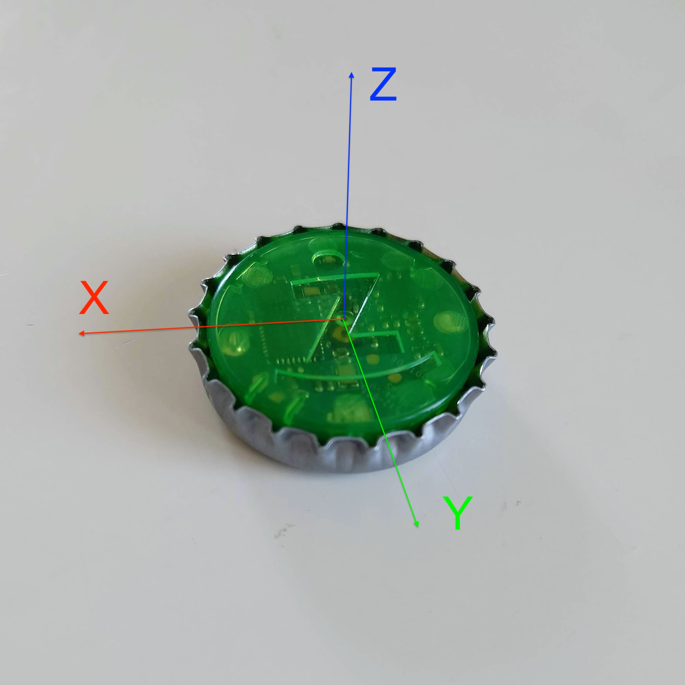

<p align="center">
  
</p>

<h1 align="center">Żabka Triki for Home Assistant</h1>

<p align="center">
  Turn the Żabka <b>Triki</b> game token into a Bluetooth remote: button, knob, gestures.<br>
  Local push, no cloud, works with a local adapter or an ESPHome Bluetooth proxy.
</p>

<p align="center">
  <a href="https://github.com/elenium3/ha-triki/actions/workflows/ci.yml"></a>
  <a href="https://github.com/elenium3/ha-triki/releases"></a>
  <a href="https://hacs.xyz"></a>
  
  <a href="LICENSE"></a>
</p>

---

## What is Triki, in plain words

<p align="center">
  
  &nbsp;&nbsp;
  
  <br><sub>The token from above and from below. Photos by <a href="https://github.com/Flopsstuff/triki">Flopsstuff</a>, MIT.</sub>
</p>

Triki is a **bottle cap with a computer inside**. Żabka, the Polish convenience
store chain, sells it for about 70 zł (and for a few złoty with app coupons) as
"the smallest game controller in the world": you pair it with the Żappka
loyalty app and play little games by pressing, tilting and shaking it. The
whole cap is one big button, there is a green LED under the Ż logo, and a
motion sensor feels how the cap is turned, tilted or thrown. It runs on a coin
cell and talks over Bluetooth Low Energy, the same radio as a fitness band.

The games are not the interesting part. The token sends its motion and button
state to whoever connects, with no account or password. Point it at Home
Assistant instead of the app and you have a **tiny wireless remote** that you
can leave on a desk, a nightstand or a kitchen counter:

- **Press** the cap to toggle a lamp. Press twice for a preset, three times for
  a party, hold it for full brightness.
- **Turn it like a knob** on the table to dim the light or change the volume.
- **Shake it** to trigger a scene (experimental; see the limitations below).
- Any gesture is just an event in Home Assistant, so it can start a timer, pause
  the TV, open the blinds, or send a notification.

It is not a replacement for a wall switch: the token sleeps when it is not
moved and needs a second to wake, and a coin cell is a coin cell. It is a
cheap, pocket-sized, rechargeable-free gadget that already exists in millions of
Polish homes and happens to speak a very simple protocol.

<p align="center">
  
  <br><sub>The sensor's axes. Z points out of the top; turning around Z is the knob gesture. Photo by <a href="https://github.com/Flopsstuff/triki">Flopsstuff</a>, MIT.</sub>
</p>

Inside the cap: an nRF52810 Bluetooth chip, an LSM6DSL
accelerometer/gyroscope, the button, the LED and a CR2032 cell. The protocol
was reverse engineered by the community (see [Credits](#credits)).
[More about the device →](docs/hardware.md)

## Features

- **Discovery** by name, pairing is just a button press.
- **Button**: press, double and triple press, long press, live button state.
- **Knob**: turn it on the table for `rotate_cw` / `rotate_ccw` with step and
  degrees. Dim a light, scroll a playlist.
- **Gestures** (opt-in, experimental): shake, tap, throw, flip.
- **Event entity** plus a bus event `triki_event` for every gesture.
- **LED** as a light entity, **battery**, **RSSI**, **tilt** sensors.
- **Battery-aware link**: the stream drops to 26 Hz when the token is idle and
  comes back on the first touch; the link is dropped after a longer idle.
- **Diagnostics** with link statistics, **raw capture** option for debugging,
  config entry migration, 95 %+ test coverage, strict typing.

## Quick start

1. Install through HACS (custom repository `elenium3/ha-triki`, type
   *Integration*) or copy `custom_components/triki` to your config. Restart.
2. Press the token's button. Home Assistant discovers *Żabka Triki*; confirm.
3. Put the Bluetooth receiver where the token is used. A five-euro ESP32 board
   flashed as an ESPHome Bluetooth proxy next to the desk or bed connects in
   under a second; a Raspberry Pi across the room does not. This matters more
   than any setting. [How to make a proxy →](docs/bluetooth-proxy.md)
   · [Why →](docs/radio-and-placement.md)
4. Automate on `event.<name>_action`:

```yaml
automation:
  - alias: "Triki: press toggles the desk lamp"
    triggers:
      - trigger: state
        entity_id: event.triki_action
    conditions:
      - "{{ trigger.to_state.attributes.event_type == 'press' }}"
    actions:
      - action: light.toggle
        target:
          entity_id: light.desk
```

Knob dimming, long press, double-press presets and a light-effect toggle are in
[Events and automations](docs/events-and-automations.md).

## Entities

| Entity | Notes |
|---|---|
| `event.<name>_action` | `wake`, `press`, `double_press`, `triple_press`, `long_press`, `rotate_cw` / `rotate_ccw` (`steps`, `degrees`), `shake`, `tap`, `throw`, `flip` |
| `binary_sensor.<name>_button` | live button state, off while asleep |
| `binary_sensor.<name>_connected` | diagnostic |
| `light.<name>_led` | the green LED; changeable only while connected |
| `sensor.<name>_battery` | read on connect and every 10 min |
| `sensor.<name>_rssi`, `_pitch`, `_roll` | disabled by default |

## Documentation

| Page | |
|---|---|
| [The token](docs/hardware.md) | what it is, what is inside, how it behaves, related projects |
| [Installation](docs/installation.md) | HACS, manual, adding the token |
| [Configuration](docs/configuration.md) | every option, idle and sleep behaviour, entities |
| [Events and automations](docs/events-and-automations.md) | event reference, gesture status, worked examples |
| [Bluetooth proxy for beginners](docs/bluetooth-proxy.md) | what it is, which ESP32 to buy, how to flash it, the full YAML, how to check it works |
| [Radio and placement](docs/radio-and-placement.md) | measured link behaviour versus signal, proxy versus local adapter |
| [Troubleshooting](docs/troubleshooting.md) | symptoms, causes, what to attach to a bug report |
| [Diagnostics](docs/diagnostics.md) | the diagnostics download, debug log, capture format |
| [Protocol](docs/protocol.md) | GATT, commands, frame format, what the app does that we do not |
| [Architecture](docs/architecture.md) | how the integration is built and why |
| [Development](docs/development.md) | setup, tests, tools, releasing |
| [Changelog](CHANGELOG.md) | |

## Known limitations

- Presses within the first few minutes after an idle disconnect are ignored
  while the token still advertises; set the sleep timeout to 0 to avoid this at
  the cost of battery. See [Configuration](docs/configuration.md#idle-and-sleep-how-the-link-behaves).
- Shake is not reliably detected through a proxy yet; use triple press.
- Tap, throw and flip are tuned on synthetic data only.
- The integration icon appears only once the brand is accepted into
  [home-assistant/brands](https://github.com/home-assistant/brands); the files
  are prepared in `brands/triki`.

## Credits

The protocol is community work; this integration stands on:

- [Flopsstuff/triki](https://github.com/Flopsstuff/triki) by Flopsstuff (MIT):
  protocol, IMU and hardware guides, photos.
- [Maku-hub/TrikiScope](https://github.com/Maku-hub/TrikiScope) and
  [TrikiEmu](https://github.com/Maku-hub/TrikiEmu) by Mateusz "Maku" Mączewski
  (MIT): the button flag, the HCI snoop analysis of the app.
- [woofter-wolf/triki-library-python](https://github.com/woofter-wolf/triki-library-python)
  by Woofter_Wolf (MIT).
- [Piwencjusz/zabka-triki-hardware](https://github.com/Piwencjusz/zabka-triki-hardware),
  [koksny/TRIKI-Control](https://github.com/koksny/TRIKI-Control) by Wojciech
  Górny (MIT), [orionas97/triki_unofficial](https://github.com/orionas97/triki_unofficial)
  (MIT, another Home Assistant integration with a sensor-oriented design).

Built on Home Assistant's [Bluetooth stack](https://www.home-assistant.io/integrations/bluetooth/),
[bleak](https://github.com/hbldh/bleak) and
[bleak-retry-connector](https://github.com/Bluetooth-Devices/bleak-retry-connector).

## License

[MIT](LICENSE). Triki, Żappka and Żabka are trademarks of their owners. This
project is not affiliated with Żabka Polska or Caps Apps, and using the token
outside the app is at your own risk.
