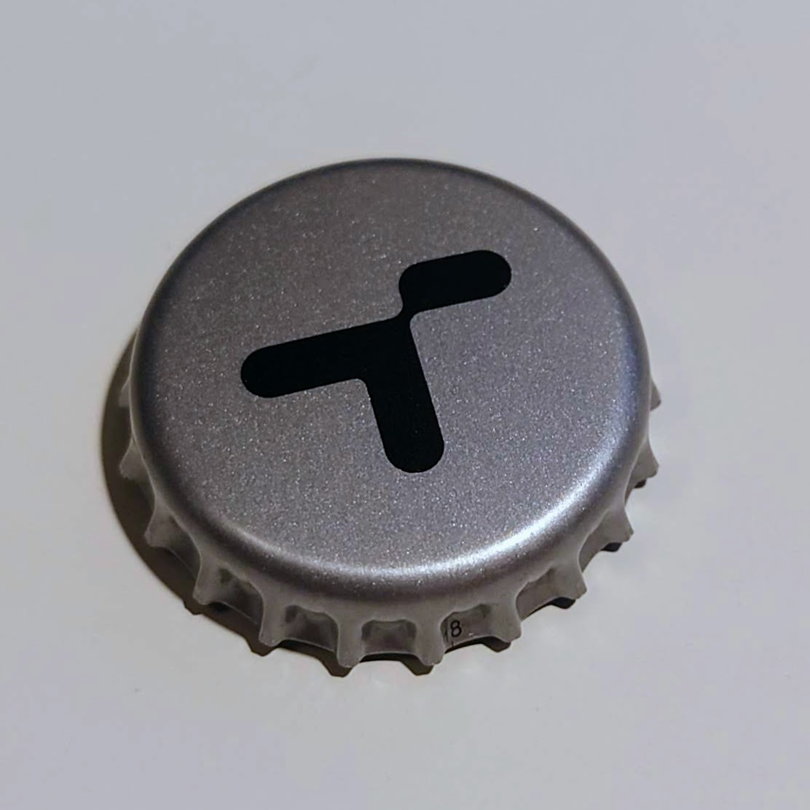
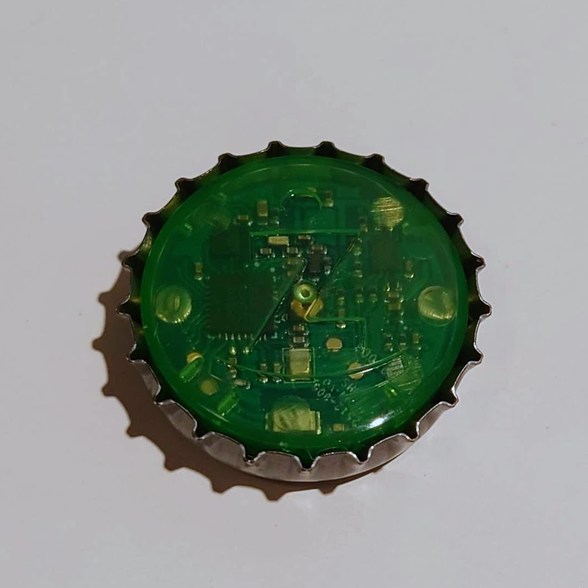

<p align="center">
  
</p>

<h1 align="center">Żabka Triki for Home Assistant</h1>

<p align="center">
  The Żabka <b>Triki</b> game token as a Bluetooth remote: button, knob, gestures.<br>
  Local push, no cloud. Works with a local adapter or an ESPHome Bluetooth proxy.
</p>

<p align="center">
  <a href="https://github.com/elenium3/ha-triki/actions/workflows/ci.yml"></a>
  <a href="https://github.com/elenium3/ha-triki/releases"></a>
  <a href="https://hacs.xyz"></a>
  
  <a href="LICENSE"></a>
</p>

## What it is

<p align="center">
  
  &nbsp;&nbsp;
  
  <br><sub>Photos: <a href="https://github.com/Flopsstuff/triki">Flopsstuff</a>, MIT.</sub>
</p>

Triki is a bottle cap with a Bluetooth chip, a motion sensor, one button (the
whole cap) and a green LED, sold by the Polish chain Żabka for games in its
Żappka app (about 70 zł, a few złoty with coupons). It runs on a CR2032 and
streams motion and button state to whoever connects, no account needed. This
integration turns it into a small remote for Home Assistant:

- **Press** toggles a lamp; double, triple and long press pick presets or scenes.
- **Turn it on the table** like a knob to dim a light or change the volume.
- **Every gesture is an event**, so it can start anything an automation can.

It sleeps when still and wakes on the first press, so it is a remote, not a
wall switch. More: [The token](docs/hardware.md).

## Quick install

[](https://my.home-assistant.io/redirect/hacs_repository/?owner=elenium3&repository=ha-triki&category=integration)

1. In [HACS](https://www.hacs.xyz/docs/use/) add this repository as a
   [custom repository](https://www.hacs.xyz/docs/faq/custom_repositories/)
   (`https://github.com/elenium3/ha-triki`, type *Integration*), install it and
   [restart Home Assistant](https://www.home-assistant.io/docs/configuration/#reloading-changes).
2. Press the token. It shows up as *Żabka Triki* under *Discovered* in
   [Settings → Devices & services](https://my.home-assistant.io/redirect/integrations/);
   confirm.
3. Automate on the [event entity](https://www.home-assistant.io/integrations/event/)
   `event.<name>_action` with a
   [state trigger](https://www.home-assistant.io/docs/automation/trigger/#state-trigger):

```yaml
automation:
  - alias: "Triki: press toggles the desk lamp"
    triggers:
      - trigger: state
        entity_id: event.triki_action
    conditions:
      - "{{ trigger.to_state.attributes.event_type == 'press' }}"
    actions:
      - action: light.toggle
        target:
          entity_id: light.desk
```

## Full installation

- **Receiver.** Home Assistant needs its
  [Bluetooth integration](https://www.home-assistant.io/integrations/bluetooth/)
  and a receiver where the token is used. An ESP32 flashed as an
  [ESPHome Bluetooth proxy](https://esphome.io/components/bluetooth_proxy.html)
  next to the desk connects in under a second; a Raspberry Pi across the room
  does not. This matters more than any option.
  [Bluetooth proxy for beginners](docs/bluetooth-proxy.md) ·
  [Radio and placement](docs/radio-and-placement.md)
- **Manual install.** Copy `custom_components/triki` into the
  `custom_components` folder of your
  [configuration directory](https://www.home-assistant.io/docs/configuration/)
  and restart. The `triki.zip` of a
  [release](https://github.com/elenium3/ha-triki/releases) holds the files
  without the folder: unpack it into `custom_components/triki/`. If it is not
  discovered, use [Add integration → Żabka Triki](https://my.home-assistant.io/redirect/config_flow_start/?domain=triki),
  press the button, pick the token. [Installation](docs/installation.md)
- **Options.** Sample rate, idle and sleep timeouts, knob step, multi-press,
  which gestures are on, raw capture. [Configuration](docs/configuration.md)
- **Automations.** Knob dimming, long press, preset cycling, a light-effect
  toggle, with YAML. [Events and automations](docs/events-and-automations.md)
- **Problems.** [Troubleshooting](docs/troubleshooting.md) ·
  [Diagnostics](docs/diagnostics.md)

## Entities

| Entity | Notes |
|---|---|
| `event.<name>_action` | `wake`, `press`, `double_press`, `triple_press` (`count`), `long_press`, `rotate_cw` / `rotate_ccw` (`steps`, `degrees`), `shake`, `tap`, `throw`, `flip` |
| `binary_sensor.<name>_button` | live button state, off while asleep |
| `binary_sensor.<name>_connected` | diagnostic |
| `light.<name>_led` | the green LED; changeable only while connected |
| `sensor.<name>_battery` | measured by the token during a short stream pause while it is idle, at most every 30 min |
| `sensor.<name>_rssi`, `_pitch`, `_roll` | disabled by default |

Every gesture is also fired on the bus as `triki_event` with `device_id`,
`address` and `type`.

## Documentation

| Page | |
|---|---|
| [The token](docs/hardware.md) | what it is, inside, board and schematic, battery, behaviour, related projects |
| [Installation](docs/installation.md) | HACS, manual, adding the token, first check |
| [Configuration](docs/configuration.md) | every option, idle and sleep behaviour |
| [Events and automations](docs/events-and-automations.md) | event reference, gesture status, worked examples |
| [Bluetooth proxy for beginners](docs/bluetooth-proxy.md) | which ESP32, how to flash, the YAML, how to check |
| [Radio and placement](docs/radio-and-placement.md) | measured link behaviour versus signal |
| [Troubleshooting](docs/troubleshooting.md) | symptoms, causes, what to attach to a bug report |
| [Diagnostics](docs/diagnostics.md) | diagnostics download, debug log, capture format |
| [Protocol](docs/protocol.md) | GATT, commands, frame format |
| [Architecture](docs/architecture.md) | how the integration is built |
| [Development](docs/development.md) | setup, tests, tools, releasing |
| [Changelog](CHANGELOG.md) | |

## Known limitations

- With a sleep timeout set, presses in the minutes after a sleep disconnect are
  ignored while the token still advertises. Keep the sleep timeout at 0.
- Shake needs about a second of hard swinging; picking the token up may
  register one rotation step before it. Tap, throw and flip are tuned on
  synthetic data only.
- The integration icon needs Home Assistant 2026.3 or newer (it ships in
  `custom_components/triki/brand/`); older versions show a placeholder.

## Credits

The protocol is community work. This integration stands on
[Flopsstuff/triki](https://github.com/Flopsstuff/triki) (Flopsstuff, MIT:
protocol, IMU, hardware, photos),
[Maku-hub/TrikiScope](https://github.com/Maku-hub/TrikiScope) and
[TrikiEmu](https://github.com/Maku-hub/TrikiEmu) (Mateusz "Maku" Mączewski,
MIT: button flag, app snoop analysis),
[woofter-wolf/triki-library-python](https://github.com/woofter-wolf/triki-library-python)
(Woofter_Wolf, MIT),
[Piwencjusz/zabka-triki-hardware](https://github.com/Piwencjusz/zabka-triki-hardware)
(board photos, pinout, schematic),
[koksny/TRIKI-Control](https://github.com/koksny/TRIKI-Control) (Wojciech
Górny, MIT) and
[orionas97/triki_unofficial](https://github.com/orionas97/triki_unofficial)
(MIT, another Home Assistant integration). Built on Home Assistant's
[Bluetooth stack](https://www.home-assistant.io/integrations/bluetooth/),
[bleak](https://github.com/hbldh/bleak) and
[bleak-retry-connector](https://github.com/Bluetooth-Devices/bleak-retry-connector).

## License

[MIT](LICENSE). Triki, Żappka and Żabka are trademarks of their owners. This
project is not affiliated with Żabka Polska or Caps Apps; using the token
outside the app is at your own risk.
