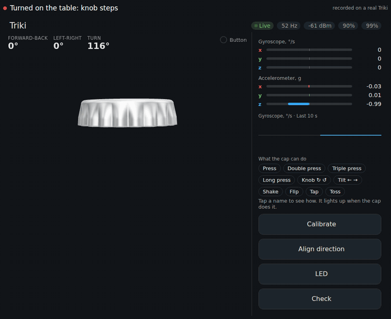
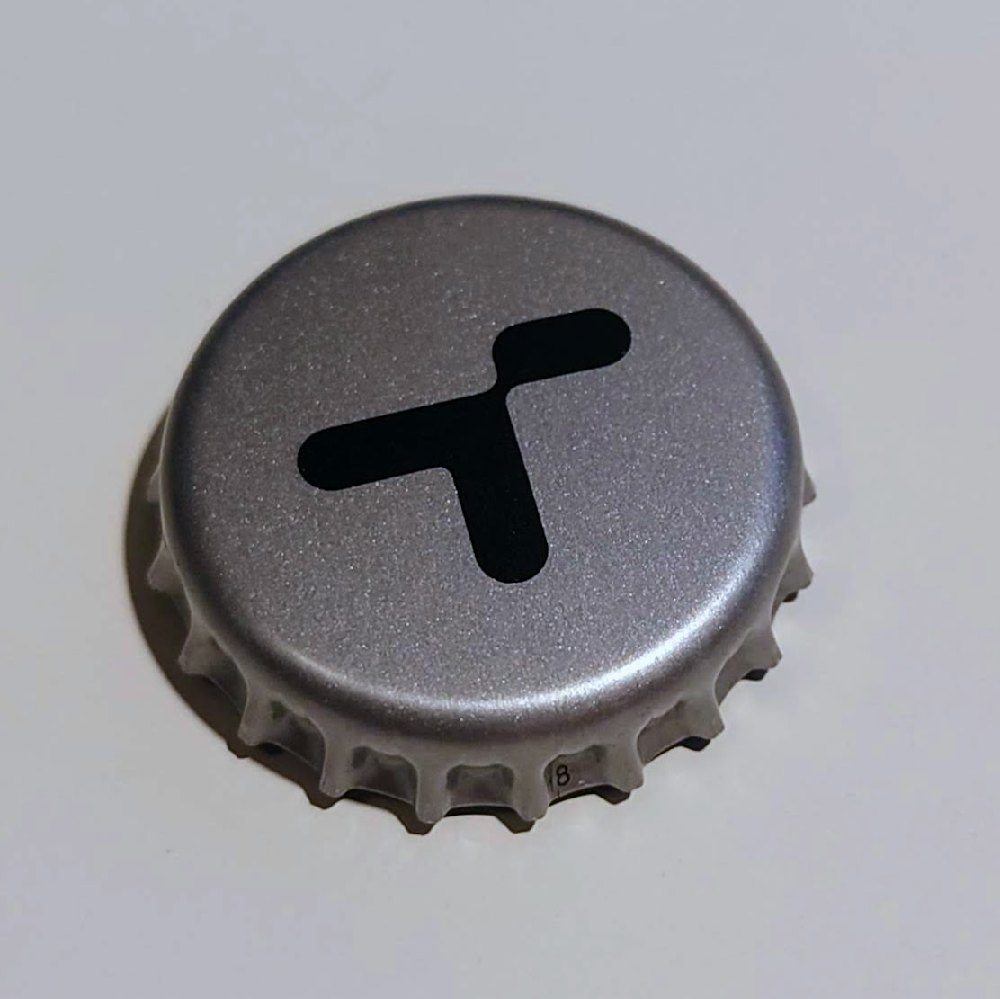
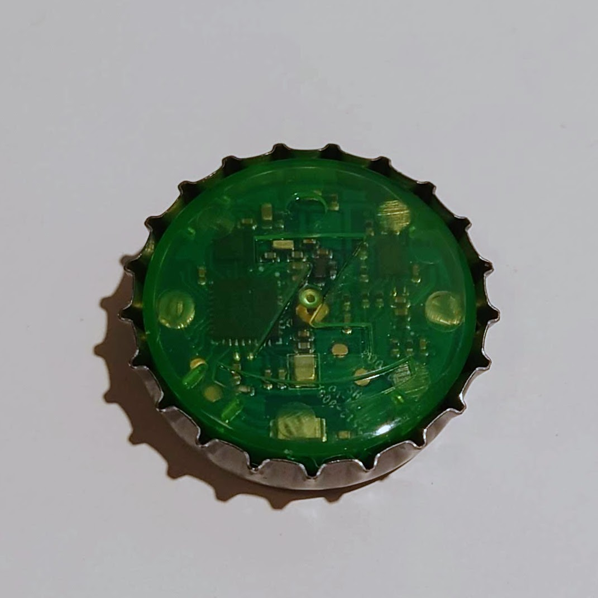

<p align="center">
  
</p>

<h1 align="center">Żabka Triki for Home Assistant</h1>

<p align="center">
  The Żabka <b>Triki</b> game token as a Bluetooth remote: button, knob, gestures.<br>
  Local push, no cloud. Works with a local adapter or an ESPHome Bluetooth proxy.
</p>

<p align="center">
  <a href="https://github.com/elenium3/ha-triki/actions/workflows/ci.yml"></a>
  <a href="https://github.com/elenium3/ha-triki/releases"></a>
  <a href="https://hacs.xyz"></a>
  
  <a href="LICENSE"></a>
</p>

<p align="center">
  
  <br><sub>The 3D card that comes with the integration, replaying a real Triki.</sub>
</p>

## What it is

<p align="center">
  
  &nbsp;&nbsp;
  
  <br><sub>Photos: <a href="https://github.com/Flopsstuff/triki">Flopsstuff</a>, MIT.</sub>
</p>

Triki is a bottle cap from Żabka's Żappka games: a Bluetooth chip, a motion
sensor, a green LED and one button, which is the whole cap. It runs on a CR2032
and talks to anyone who connects, no account needed. Here it becomes a remote:
press to toggle a lamp, turn it on the table to dim, lean or shake it to start
a scene. It sleeps when left alone and wakes on a press.

## Install

[](https://my.home-assistant.io/redirect/hacs_repository/?owner=elenium3&repository=ha-triki&category=integration)

1. Find *Żabka Triki* in [HACS](https://www.hacs.xyz/docs/use/), download it and
   [restart Home Assistant](https://www.home-assistant.io/docs/configuration/#reloading-changes).
2. Press the cap. It appears under *Discovered* in
   [Settings → Devices & services](https://my.home-assistant.io/redirect/integrations/): confirm
   and tick the gestures you want besides press and long press.
3. Add the **Triki live 3D** card to a dashboard and press **Check** on it (as an admin). It
   walks you through the button, the knob and the gestures in a few minutes and
   offers the option changes your cap needs in one tap. If the card is not in
   the list, reload the page.

You need a Bluetooth receiver near the cap. An ESP32 running
[ESPHome Bluetooth proxy](https://esphome.io/components/bluetooth_proxy.html)
next to the desk connects in under a second; a Raspberry Pi across the room
may not. Nothing else matters as much:
[Bluetooth proxy for beginners](docs/bluetooth-proxy.md).

Manual install, without HACS: [Installation](docs/installation.md).

## What it can do

| Gesture | How | Event | Out of the box |
|---|---|---|---|
| Press | press the cap | `single_press` | on |
| Long press | press and hold, let go | `long_press_start`, `long_press_end` | on |
| Double, triple press | two or three quick presses | `multi_press` with `press_count` 2 or 3 | off: it delays a single press by half a second |
| Knob | turn it flat on the table | `rotate_cw`, `rotate_ccw` | off |
| Tilt | hold it level, lean right or left | `tilt_right`, `tilt_left` | off |
| Shake | a second of sharp shaking | `shake` | off |
| Flip, tap, toss | experimental | `flip`, `tap`, `throw` | off |

Gestures are picked when the cap is added; change them later in *Configure*.

**No YAML needed:** import a blueprint and pick the cap.

| Blueprint | |
|---|---|
| Light remote: press toggles, the knob dims, long press sets full brightness | [](https://my.home-assistant.io/redirect/blueprint_import/?blueprint_url=https%3A%2F%2Fgithub.com%2Felenium3%2Fha-triki%2Fblob%2Fmain%2Fblueprints%2Fautomation%2Ftriki%2Ftriki_light.yaml) |
| An action for each gesture: press, double, triple and long press, knob, tilt, shake, flip | [](https://my.home-assistant.io/redirect/blueprint_import/?blueprint_url=https%3A%2F%2Fgithub.com%2Felenium3%2Fha-triki%2Fblob%2Fmain%2Fblueprints%2Fautomation%2Ftriki%2Ftriki_actions.yaml) |

If a press does nothing, look at the card or the *Readiness* sensor: *Dozing
off* means the cap went idle and misses presses for about 3 minutes. Wait
rather than press again.

Or build one in the automation editor: *Add trigger → Device → your Triki*
and pick the gesture. In YAML every gesture arrives on `event.<name>_action`.
The name carries the cap's number, for example
`event.triki_4190656753_action`: put your cap's entity in place of
`event.triki_action` below.

```yaml
automation:
  - alias: "Triki: press toggles the desk lamp"
    triggers:
      - trigger: state
        entity_id: event.triki_action
        not_from: unavailable  # a restart restores the last event
    conditions:
      - "{{ trigger.to_state.attributes.event_type == 'single_press' }}"
    actions:
      - action: light.toggle
        target:
          entity_id: light.desk
```

Knob dimming, presets, scenes: [Events and automations](docs/events-and-automations.md).

## The card

The animation above is the card: the cap in 3D, live sensor readings, a list of
gestures that light up as they fire, and buttons for **Calibrate**, **Align
direction**, **LED** and **Check**. Need only a part of it, say just the LED
button? Switch the rest off in the card's settings. [Live 3D card](docs/live-card.md)

## Battery

- **Leave *Disconnect after idle* at 300 s.** The cap sleeps and a press wakes
  it. At 0 the link never drops and a fresh CR2032 is empty in about a week.
- **Swap the cell at the first warning.** Home Assistant raises a repair notice
  at 30 %. Below that the cap can freeze until the cell is taken out and put
  back.
- **Upgrading from 0.2.4 or earlier?** Those versions suggested 0: set 300 s
  (the repair notice does it for you). Cap not reacting?
  [Troubleshooting](docs/troubleshooting.md#the-token-stops-responding-and-only-a-battery-pull-brings-it-back).

<details>
<summary><b>Entities</b></summary>

| Entity | Notes |
|---|---|
| `event.<name>_action` | `wake`, `single_press`, `multi_press` (`press_count`), `long_press_start`, `long_press_end`, `rotate_cw` / `rotate_ccw` (`steps`, `degrees`, `speed`, `position`), `tilt_left` / `tilt_right` (`repeat`), `shake`, `tap`, `throw`, `flip` |
| `binary_sensor.<name>_button` | live button state, off while asleep |
| `binary_sensor.<name>_connected` | diagnostic |
| `number.<name>_knob_position` | where the knob stands, 0-100 %; settable; exists while the knob is on |
| `switch.<name>_led` | the green LED, on and off buttons: the cap can't report it; changeable only while connected |
| `sensor.<name>_battery` | measured while idle, at most every 30 min |
| `sensor.<name>_readiness` | whether a press gets through now: `connected`, `dozing` (about 3 min after an idle disconnect, presses are missed), `asleep` (a press wakes it), `not_responding` |
| `sensor.<name>_link_quality` | % of motion frames that arrived in the last session; a repair notice after three lossy sessions in a row |
| `sensor.<name>_face_up` | `cap_up`, `pcb_up` or `edge`, once the cap lies still |
| `sensor.<name>_signal_strength`, `_tilt_left_right`, `_tilt_forward_back` | disabled by default (the tilt sensors are `_pitch` and `_roll` on installs made before 0.3.0) |

Every gesture also fires `triki_event` on the bus, with `device_id`, `address`
and `type`.

</details>

## Documentation

| Page | |
|---|---|
| [The token](docs/hardware.md) | what it is, inside, board and schematic, battery, behaviour, related projects |
| [Installation](docs/installation.md) | HACS, manual, adding the token, first check |
| [Configuration](docs/configuration.md) | every option, idle and sleep behaviour |
| [Events and automations](docs/events-and-automations.md) | event reference, gesture status, worked examples |
| [Live 3D card](docs/live-card.md) | the 3D card, orientation, websocket API |
| [Bluetooth proxy for beginners](docs/bluetooth-proxy.md) | which ESP32, how to flash, the YAML, how to check |
| [Radio and placement](docs/radio-and-placement.md) | measured link behaviour versus signal |
| [Troubleshooting](docs/troubleshooting.md) | symptoms, causes, what to attach to a bug report |
| [Diagnostics](docs/diagnostics.md) | diagnostics download, debug log, capture format |
| [Protocol](docs/protocol.md) | GATT, commands, frame format |
| [Architecture](docs/architecture.md) | how the integration is built |
| [Development](docs/development.md) | setup, tests, tools, releasing |
| [Changelog](CHANGELOG.md) | |

## Known limitations

- For about 3 minutes after an idle disconnect the cap still advertises and
  presses are missed; once it sleeps, a press wakes it. The card shows this as
  *dozing*. [Why](docs/configuration.md#idle-and-sleep-how-the-link-behaves)
- Flip, tap and toss were tuned on a single session: expect misses.
- With *Disconnect after idle* at 0 the battery reads low (it is measured
  under load).
- After a Home Assistant restart the card's model does not know which way the
  cap points until **Align direction**; the card says so.
- The integration icon needs Home Assistant 2026.3 or newer.

## Credits

The protocol is community work. This integration stands on
[Flopsstuff/triki](https://github.com/Flopsstuff/triki) (Flopsstuff, MIT:
protocol, IMU, hardware, photos, the 3D model used by the live card),
[Maku-hub/TrikiScope](https://github.com/Maku-hub/TrikiScope) and
[TrikiEmu](https://github.com/Maku-hub/TrikiEmu) (Mateusz "Maku" Mączewski,
MIT: button flag, app snoop analysis),
[woofter-wolf/triki-library-python](https://github.com/woofter-wolf/triki-library-python)
(Woofter_Wolf, MIT),
[Piwencjusz/zabka-triki-hardware](https://github.com/Piwencjusz/zabka-triki-hardware)
(board photos, pinout, schematic),
[koksny/TRIKI-Control](https://github.com/koksny/TRIKI-Control) (Wojciech
Górny, MIT) and
[orionas97/triki_unofficial](https://github.com/orionas97/triki_unofficial)
(MIT, another Home Assistant integration). The live card renders with
[three.js](https://threejs.org/) (MIT). Built on Home Assistant's
[Bluetooth stack](https://www.home-assistant.io/integrations/bluetooth/),
[bleak](https://github.com/hbldh/bleak) and
[bleak-retry-connector](https://github.com/Bluetooth-Devices/bleak-retry-connector).

## License

[MIT](LICENSE). Triki, Żappka and Żabka are trademarks of their owners. This
project is not affiliated with Żabka Polska or Caps Apps; using the token
outside the app is at your own risk.
