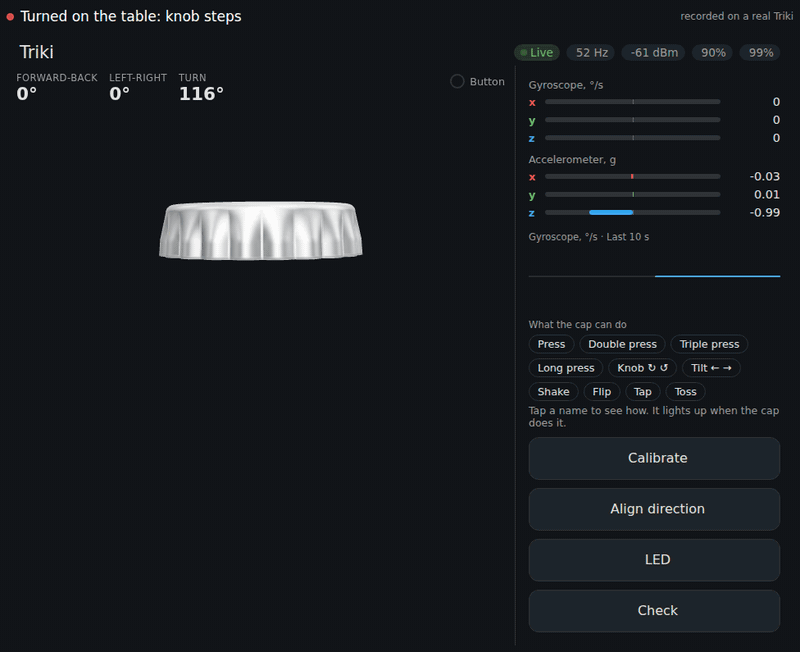

<p align="center">
  
</p>

<h1 align="center">Żabka Triki w Home Assistancie</h1>

<p align="center">
  Kapsel <b>Triki</b> z gier Żappki jako pilot Bluetooth: przycisk, pokrętło, gesty.<br>
  Działa lokalnie, bez chmury. Wystarczy adapter Bluetooth albo ESPHome Bluetooth Proxy.
</p>

<p align="center">
  <a href="README.md">English</a> ·
  <a href="https://elenium3.github.io/ha-triki/pl/">O samym kapslu: bateria, połączenie, użycie bez aplikacji</a>
</p>

<p align="center">
  
  <br><sub>Karta 3D dołączona do integracji odtwarza nagranie prawdziwego kapsla.</sub>
</p>

## Co to jest

Triki to kapsel z gier w aplikacji Żappka: układ Bluetooth, czujnik ruchu,
zielona dioda i jeden przycisk, którym jest cały kapsel. Zasila go bateria
CR2032, a połączyć się z nim może każde urządzenie, bez konta. Tutaj staje się
pilotem: naciśnięcie przełącza lampę, obrót na stole ją ściemnia, przechył albo
potrząśnięcie uruchamia scenę. Odłożony zasypia, a naciśnięcie go budzi.

## Instalacja

[](https://my.home-assistant.io/redirect/hacs_repository/?owner=elenium3&repository=ha-triki&category=integration)

1. Znajdź *Żabka Triki* w [HACS](https://www.hacs.xyz/docs/use/), pobierz
   integrację i uruchom ponownie Home Assistanta.
2. Naciśnij kapsel. Pojawi się w sekcji *Wykryte* na stronie
   [Ustawienia → Urządzenia oraz usługi](https://my.home-assistant.io/redirect/integrations/):
   potwierdź i zaznacz gesty, których chcesz używać oprócz naciśnięcia i
   długiego naciśnięcia.
3. Dodaj do dashboardu kartę **Triki live 3D** i naciśnij na niej **Test** (jako
   administrator). W kilka minut przeprowadzi cię przez sprawdzenie przycisku,
   pokrętła i gestów, a na koniec zaproponuje zmiany opcji, które zapiszesz
   jednym kliknięciem. Jeśli
   karty nie ma na liście, odśwież stronę.

Blisko kapsla musi być odbiornik Bluetooth. Płytka ESP32 z
[ESPHome Bluetooth Proxy](https://esphome.io/components/bluetooth_proxy.html)
obok biurka łączy się w niecałą sekundę; Raspberry Pi na drugim końcu pokoju
może nie połączyć się wcale. Nic innego nie ma takiego znaczenia:
[Bluetooth proxy dla początkujących](docs/bluetooth-proxy.md) (po angielsku).

Instalacja ręczna, bez HACS: [Installation](docs/installation.md) (po angielsku).

## Co potrafi

| Gest | Jak | Zdarzenie | Domyślnie |
|---|---|---|---|
| Naciśnięcie | naciśnij kapsel | `single_press` | włączone |
| Długie naciśnięcie | naciśnij, przytrzymaj i puść | `long_press_start`, `long_press_end` | włączone |
| Podwójne i potrójne naciśnięcie | dwa albo trzy szybkie naciśnięcia | `multi_press` z `press_count` 2 albo 3 | wyłączone: opóźnia pojedyncze naciśnięcie o pół sekundy |
| Pokrętło | obracaj kapsel leżący płasko na stole | `rotate_cw`, `rotate_ccw` | wyłączone |
| Przechył | trzymaj poziomo i przechyl w prawo albo w lewo | `tilt_right`, `tilt_left` | wyłączone |
| Potrząśnięcie | potrząsaj mocno przez sekundę | `shake` | wyłączone |
| Odwrócenie, stuknięcie, podrzut | eksperymentalne | `flip`, `tap`, `throw` | wyłączone |

Gesty wybierasz przy dodawaniu kapsla; później zmienisz je w *Konfiguruj*.

**Bez YAML-a:** zaimportuj schemat (blueprint) i wybierz kapsel.

| Schemat | |
|---|---|
| Pilot do światła: naciśnięcie przełącza, pokrętło ściemnia, długie naciśnięcie ustawia pełną jasność | [](https://my.home-assistant.io/redirect/blueprint_import/?blueprint_url=https%3A%2F%2Fgithub.com%2Felenium3%2Fha-triki%2Fblob%2Fmain%2Fblueprints%2Fautomation%2Ftriki%2Ftriki_light.yaml) |
| Akcja dla każdego gestu: naciśnięcie pojedyncze, podwójne, potrójne i długie, pokrętło, przechył, potrząśnięcie, odwrócenie | [](https://my.home-assistant.io/redirect/blueprint_import/?blueprint_url=https%3A%2F%2Fgithub.com%2Felenium3%2Fha-triki%2Fblob%2Fmain%2Fblueprints%2Fautomation%2Ftriki%2Ftriki_actions.yaml) |

Jeśli naciśnięcie nic nie robi, spójrz na kartę albo na czujnik *Gotowość*:
*Zasypia* oznacza, że kapsel rozłączył się po bezczynności i przez około
3 minuty nie odbiera naciśnięć. Poczekaj, zamiast naciskać ponownie.

Automatyzację zbudujesz też w edytorze: wybierz *Dodaj wyzwalacz → Urządzenie →
Twój Triki*, a potem gest. W YAML-u każdy gest trafia do encji
`event.<nazwa>_action`. Nazwa zawiera numer kapsla, na przykład
`event.triki_4190656753_action`: wpisz encję swojego kapsla zamiast
`event.triki_action` w przykładzie poniżej.

```yaml
automation:
  - alias: "Triki: naciśnięcie przełącza lampkę na biurku"
    triggers:
      - trigger: state
        entity_id: event.triki_action
        not_from: unavailable  # po restarcie wraca ostatnie zdarzenie
    conditions:
      - "{{ trigger.to_state.attributes.event_type == 'single_press' }}"
    actions:
      - action: light.toggle
        target:
          entity_id: light.desk
```

Ściemnianie pokrętłem, ustawienia światła, sceny:
[Events and automations](docs/events-and-automations.md) (po angielsku).

## Karta

Animacja u góry to właśnie karta: kapsel w 3D, odczyty czujników na żywo, lista
gestów, które podświetlają się w chwili wykonania, oraz przyciski **Kalibruj**,
**Wyrównaj kierunek**, **Dioda** i **Test**. Potrzebujesz tylko części, na
przykład samego przycisku diody? Resztę wyłączysz w ustawieniach karty.
[Live 3D card](docs/live-card.md) (po angielsku).

## Bateria

- **Zostaw *Rozłączenie po bezczynności* ustawione na 300 s.** Kapsel zasypia, a
  naciśnięcie go budzi. Przy 0 połączenie nigdy się nie kończy i nowa CR2032
  wyczerpuje się w mniej więcej tydzień.
- **Wymień baterię przy pierwszym ostrzeżeniu.** Przy 30 % Home Assistant
  pokazuje zgłoszenie w *Naprawach*. Poniżej tego poziomu kapsel może się
  zawiesić i ożyje dopiero po wyjęciu i ponownym włożeniu baterii.
- **Aktualizujesz z wersji 0.2.4 lub starszej?** Tamte wersje zalecały 0: ustaw
  300 s (zrobi to za ciebie zgłoszenie w *Naprawach*). Kapsel nie reaguje?
  [Troubleshooting](docs/troubleshooting.md#the-token-stops-responding-and-only-a-battery-pull-brings-it-back)
  (po angielsku).

## Znane ograniczenia

- Przez około 3 minuty po rozłączeniu z powodu bezczynności kapsel nadal
  nadaje, ale naciśnięcia nie docierają; gdy zaśnie, naciśnięcie go budzi.
  Karta pokazuje to jako *Zasypia*.
  [Dlaczego tak się dzieje](docs/configuration.md#idle-and-sleep-how-the-link-behaves)
  (po angielsku).
- Odwrócenie, stuknięcie i podrzut dobrano na podstawie jednego nagrania: nie
  zawsze zadziałają.
- Gdy *Rozłączenie po bezczynności* jest ustawione na 0, odczyt baterii jest
  zaniżony (bo mierzy się ją pod obciążeniem).
- Po restarcie Home Assistanta model na karcie nie wie, w którą stronę
  zwrócony jest kapsel, dopóki nie naciśniesz **Wyrównaj kierunek**; karta o
  tym informuje.
- Ikona integracji wymaga Home Assistanta 2026.3 lub nowszego.

## Dokumentacja

Dokumentacja jest po angielsku. Spis stron, lista encji i podziękowania dla
autorów projektów, z których korzysta integracja, są w
[angielskim README](README.md#documentation). Historia zmian:
[Changelog](CHANGELOG.md).

## Licencja

[MIT](LICENSE). Triki, Żappka i Żabka są znakami towarowymi swoich właścicieli.
Projekt nie jest powiązany z firmą Żabka Polska ani z Caps Apps; kapsla poza
aplikacją używasz na własną odpowiedzialność.
