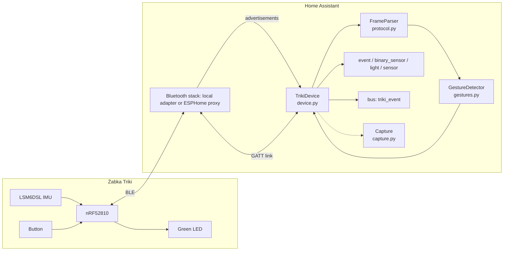
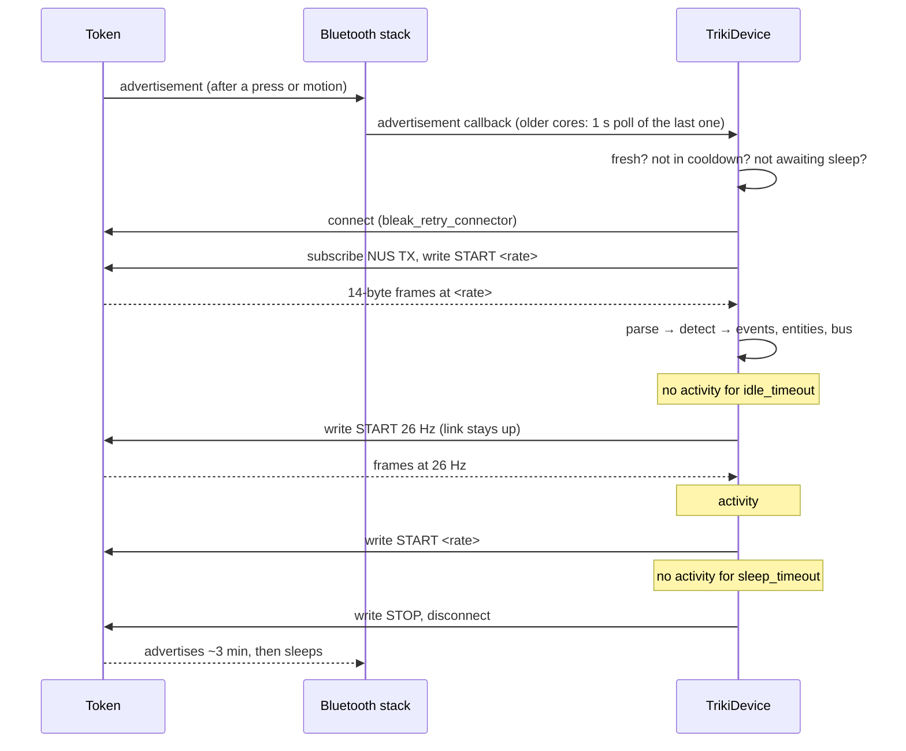

# Architecture

## Lifecycle of a session

## Design decisions

**Every advertisement, or a poll.** On Home Assistant 2026.10 and newer
`TrikiDevice` registers for every advertisement of the token's address
(`async_register_advertisement_callback`), so a wake-up is seen on the first
packet. Older cores call advertisement callbacks only when the advertised data
changes; the token always advertises the same payload, so after the first
wake-up the callback goes silent. There the device also polls the last seen
advertisement once per second and treats one younger than 10 s as "awake now".
The `advertisements` block in diagnostics shows which path is in use and the
cadence of the last 32 packets.

**Gesture timing on the arrival clock.** Frames reach the detector with their
arrival time; the frames of one notification are spread one sample period
apart. Windows (shake, multi-press, long press, motion debounce) are measured
in seconds of that clock, so a lossy link or the 26 Hz idle rate stretches
nothing. A burst of buffered notifications advances the clock by at least one
sample period per frame.

**Keep the link on idle.** A fresh link is slow and lossy for 10–20 s and a
dropped link makes the token advertise at full power for minutes. Re-sending
START at 26 Hz over the live link costs a quarter of the traffic and keeps the
button responsive. The configured rate comes back on the first frame with
activity; a write already in flight re-checks activity when it completes so
nothing is lost in the gap.

**No reconnect after an idle disconnect until the token slept.** Reconnecting
while the token still advertises after a drop resets its sleep timer and
produces an endless loop. The device waits for 15 s without advertisements
before arming for the next wake-up. The cost is described in
[Configuration](configuration.md#idle-and-sleep-how-the-link-behaves).

**Resume is not wake.** A reconnect within 5 s of a drop is a resume of the same
awake session (a weak-signal link loss) and does not emit `wake` again.

**Duplicate and stale notifications.** BlueZ may deliver one notification
several times; chunks identical to the previous one within 3 ms are dropped.
Notifications from a client that is no longer the current one are ignored.

**Start-up discard.** The first 20 frames after START are noise from the IMU
settling and are skipped, but the button state is tracked through them. A rate
switch over the live link does not re-arm the discard.

**Gesture detector without Home Assistant.** `gestures.py` and `protocol.py`
are plain Python so the probe and replay tools and the unit tests run them
unchanged. Thresholds live at the top of `gestures.py`.

**Options are a frozen dataclass.** `TrikiOptions.from_entry()` parses the
entry once; changing options reloads the entry. Config entry version 2 migrates
the v1 `idle_timeout` (which dropped the link) to `sleep_timeout`.

**Tasks die with the entry.** Every background task is created through
`entry.async_create_background_task`, so unloading the entry cancels connects,
rate writes and info reads.
