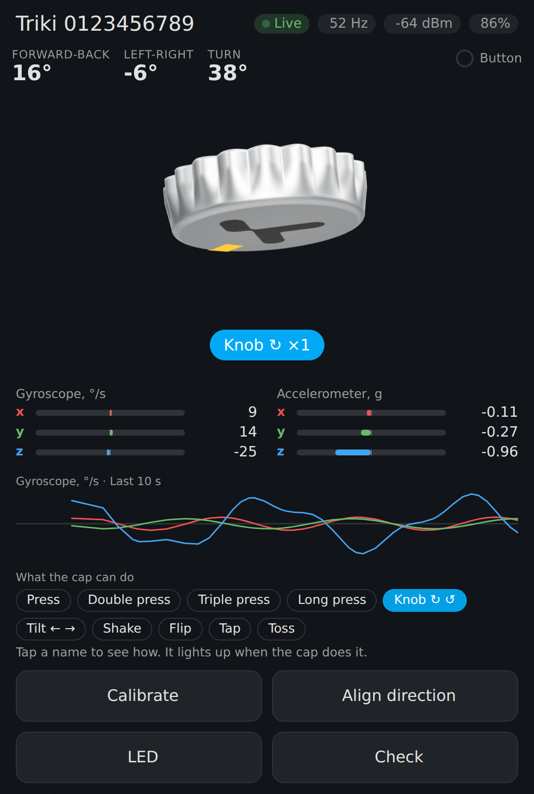

# Live 3D card

The integration ships a Lovelace card, `custom:triki-card`. It shows a 3D model
of the token that moves with the real one, its tilt left-right and
forward-back and its turn about the axis, the gyroscope and accelerometer
readings, a 10 s gyro graph, the button, battery, signal and stream rate, and
a short label for each gesture.

<p align="center"></p>

Nothing needs installing: the integration serves the card and loads it into the
frontend itself. After an update, reload the browser page once.

## Adding it

Edit a dashboard, add a card and search for **Triki live 3D**, or in YAML:

```yaml
type: custom:triki-card
device_id: 0123456789abcdef0123456789abcdef  # optional with a single token
title: Triki                                  # optional, defaults to the token's name
show_model: true                              # the 3D model and its angles
chips: [state, rate, signal, battery, link]   # which status chips; [] hides them
show_values: true                             # gyro and accelerometer bars
show_history: true                            # 10 s gyro graph
buttons: [calibrate, align, led, check]       # which buttons; [] hides the row
show_help: true                               # the help under the buttons
model: cap                                    # cap (built in) or glb (textured)
```

Every part can be hidden on its own. A card with only the LED switch:

```yaml
type: custom:triki-card
show_model: false
chips: []
show_values: false
show_history: false
buttons: [led]
show_help: false
```

Without the model, a check or a calibration still shows it while it runs: their
hints are drawn on it. Calibrate and Check appear for admins only. The older
`show_controls: false` still works and hides every button and the help, and
`show_status: false` every chip. The `link` chip is the share of frames that
arrived in the session (the *Link quality* sensor, while linked the session so
far).

The token has to be awake for the model to move: press its button. While it
sleeps the card shows the last state greyed out.

**Several tokens.** Without `device_id` the card shows a row of tabs: **Auto**
and one per token, each with a dot that is green while the token streams. Auto
shows whichever token wakes up; a token's tab pins that one. The choice is kept
per browser. With `device_id` set the card shows that token only and no tabs.

**Calibration.** The front of the token is the dot above the Żabka Z on the
PCB (sensor -y). Lay the token flat on the table, either side up, front away
from you, and press **Calibrate**. That levels it on this table (the cap then
shows edge-on, the camera is at table height) and zeroes the heading with the
front away from the viewer. A second step sets the metal logo's angle: the crown is crimped on at any angle,
so on two tokens the logo and the Z differ (photos 2026-11-18: about 30° and
-111°). With the token green side up, Z upright, turned over across its right
edge, the owner turns a picture of the logo with a slider until it matches;
`triki/calibrate` with `step: logo, angle: <degrees>` stores it. Both are kept
per token in its config entry;
`triki/calibrate` with `step: clear` forgets it. Calibration only aligns the
model: gestures and sensors measure against gravity and do not use it.

**Check** (admins only) walks through the link, the knob, the presses and the
gestures that are turned on, and judges each step. Any step can be skipped.

| Step | What it measures |
|---|---|
| Lying still | frames received against streamed (link loss), sensor noise, the receiver |
| Starting position, Tilt | the model's calibration |
| Knob clockwise, counter-clockwise | steps against the angle turned, wrong-way steps |
| Pick up and put down | five pick-ups the way the owner usually picks it up; every gesture that fires meanwhile is a false one |
| Lean in the hand | right and left, three times each |
| Button | press, double press, long press; the gap of a double press that came as two |
| Turn over, Tap, Toss | the face and the motion gestures |
| Shake | three shakes; a burst of fast rotation with no shake event is a miss (*2 of 3 recognised*) |
| Direction drift | how far the heading moves in 30 s at rest |
| Sleep and wake (optional, ~4 min) | the link drops as after idling, the token dozes (presses not seen) and sleeps, then one press must wake it: it fails if it reconnects while dozing or never falls asleep |

A gesture that fires during a step that did not ask for it is reported. When
the results point to a setting, the summary suggests it and **Save to options** saves it;
nothing changes without that press. It suggests only clear cases:

| Seen in the check | Suggestion |
|---|---|
| Both turns gave steps the other way round while the hand turned the asked way | switch *Invert rotation direction* |
| More than 30 % of the frames lost at more than 26 Hz | sensor rate 26 Hz |
| The double press came as two presses | a multi-press window that fits the measured gap (up to 0.8 s) |
| Shake or *Tilt in the hand* fired by itself twice or more | turn that gesture off |

Saving reloads the integration's entry, as saving the options form does: the
link drops and the token reconnects (if it is asleep, on its next press).

**Models.** `model: cap` (the default) is a procedural model built from calipered
dimensions, in the sensor frame; its resin glows while the LED is on and sinks
while the button is held. `model: glb` uses Flopsstuff's textured model.

## How it works

- **Orientation** is computed in the integration (`orientation.py`): a Madgwick
  filter over the gyro and accelerometer, using the gyro offset the gesture
  detector learns while the token lies still. Tilt is held to gravity; the
  accelerometer is ignored while it reads far from 1 g (a swing or a tap).
- **Heading drifts.** There is no compass, so yaw is only the integrated gyro.
  **Align direction** on the card opens a step with a picture of the green side, the dot above the Z circled: lay the cap with that edge away and press Done. A
  dozing token keeps its heading over the reconnect; a Home Assistant restart
  loses it. The calibration itself is stored and never resets; the help under
  the buttons says when to use each. The angles are labelled left-right
  (roll), forward-back (pitch) and turn about the axis (yaw). Left-right is
  read from the side that is up, so a cap lying flat shows 0° either side up
  (the `euler` the card receives, like the *Tilt left-right* sensor, reads
  ±180° metal side up).
- **Data path:** the card subscribes over Home Assistant's websocket
  (`triki/subscribe`). The integration sends the pose and the last frame at up
  to 30 messages per second while a card is open, and nothing when none is.
  Motion is never written to entity states, so the recorder and the database
  are not touched.
- **3D:** [three.js](https://threejs.org/) (MIT), bundled as
  `frontend/triki-three.js`, loaded only when a card is on screen. Rendering
  stops while the card is off screen or the model is still.

## Websocket API

| Command | Fields | Reply |
|---|---|---|
| `triki/devices` | | `[{device_id, name}]` |
| `triki/subscribe` | `device_id` (optional with one token) | events: `status`, `motion`, `event` |
| `triki/reset_heading` | `device_id` (optional with one token) | |
| `triki/check` (admin) | `device_id`, `session`, `action`: `start` (or renew, every few seconds), `stop`, `sleep` (drop the link as after idling, for the sleep step) | error `busy` when another card checks this token, `not_ready` for `sleep` while not connected |
| `triki/apply` (admin) | `device_id`, `options`: any of `invert_rotation`, `sample_rate`, `multi_press_window`, `shake`, `tilt` | `{applied}`; the entry reloads |

When the entry reloads (options saved), each subscription gets a `reload` event
and ends; subscribe again to follow the new device object.

`motion` carries `quaternion` (w, x, y, z, sensor frame, +z out of the logo
side), `euler` (roll, pitch, yaw in degrees), `gyro` (°/s, offset removed),
`accel` (g) and `button`.

## Model

The model is `triki_texture.glb` from
[Flopsstuff/triki](https://github.com/Flopsstuff/triki) (MIT), with its
textures resized to 1024 px WebP and the mesh quantized (6.2 MB to 0.4 MB) with
[glTF-Transform](https://gltf-transform.dev/):

```sh
npx @gltf-transform/cli optimize triki_texture.glb triki.glb \
  --compress quantize --texture-compress webp --texture-size 1024 --simplify false
```
